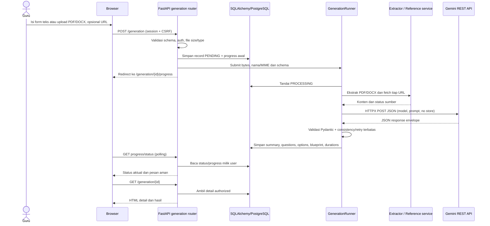

# Alur komunikasi

Endpoint submit merespons sebelum generation selesai; browser refresh hanya membaca status dan tidak mengirim generation baru. Isi upload dibaca sebelum background submit lalu direkonstruksi sebagai `UploadFile` worker dengan MIME. Hasil PDF/DOCX privat dilayani dengan endpoint ownership-checked.
