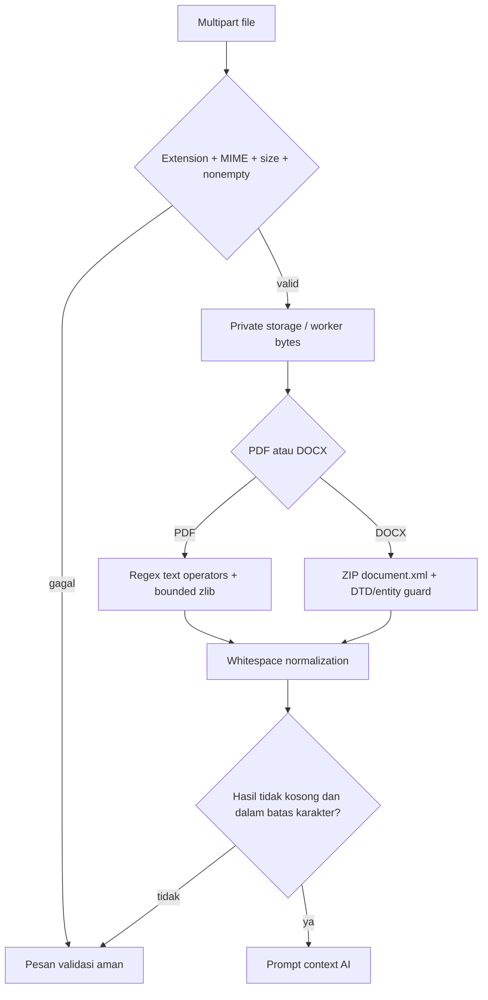

# Pemrosesan dokumen dan URL

## A. PDF / DOCX

1. Form multipart FastAPI menerima `UploadFile`; backend memeriksa ekstensi, MIME, file tidak kosong, ukuran terhadap `MAX_UPLOAD_SIZE` (default 10 MiB) dan aturan upload.
2. File disimpan ke area private generation/storage; background runner menyimpan bytes di memori request lalu merekonstruksi `UploadFile` dengan nama dan MIME untuk worker. Konfigurasi storage dan reverse proxy harus konsisten.
3. `MaterialExtractor` mendukung `.pdf` dan `.docx`. PDF saat ini diekstrak menggunakan regex atas stream/operator teks dan zlib; bukan renderer/OCR PDF penuh. PDF image-only, font encoding kompleks, layout kolom, tabel, dan object stream tertentu dapat gagal atau kehilangan urutan.
4. DOCX membaca `word/document.xml`, membatasi XML 25 MiB, menolak deklarasi DTD/entity, menggabungkan teks paragraf. Tabel/header/footer mungkin tidak seluruhnya direpresentasikan.
5. Normalisasi whitespace dan batas karakter konfigurasi dilakukan sebelum AI. PDF decompressed stream dibatasi 24 MiB; panjang keseluruhan hasil juga dibatasi oleh pengaturan. Batas karakter bukan batas memori upload; upload bytes berada di memory/temp lifecycle dan file size dibatasi terpisah.
6. Hasil ekstraksi kosong/malformed ditolak. Status, karakter, estimasi token, MIME/ukuran dicatat tanpa isi lengkap.



## B. Referensi URL

Setiap URL diproses tersendiri. Hanya HTTP/HTTPS, tanpa kredensial, host localhost/metadata dan IP non-global diblokir. DNS dan semua hasil redirect divalidasi lagi, redirect maksimal lima, port hanya default 80/443, timeout 12 detik, ukuran response maksimal 2 MiB. HTTPX `trust_env=False`, follow redirects dimatikan, response stream dibaca terbatas. Hanya text/html, text/plain, application/xhtml+xml. Parser HTML mengeluarkan teks dan batas karakter berlaku. Referensi gagal dicatat dengan sebab dan tidak dimasukkan sebagai konten.

```mermaid
flowchart TD
  A[URL user] --> B[Parse URL, HTTP(S), no credentials]
  B --> C[DNS/IP public + host/port check]
  C --> D[HTTPX streaming request timeout]
  D --> E{Redirect?}
  E -->|ya, <=5| F[Resolve relative target; validate again]
  F --> C
  E -->|lebih dari 5 / loop| X[Failure reason]
  E -->|tidak| G[Status + MIME + byte limit]
  G --> H[Parse HTML/text; whitespace; char limit]
  H --> I{Konten teks ada?}
  I -->|ya| J[Reference context + attribution]
  I -->|tidak| X
```

Tidak ada browser rendering/JavaScript execution, OCR, ekstraksi gambar, atau dukungan format selain PDF/DOCX yang terverifikasi.
